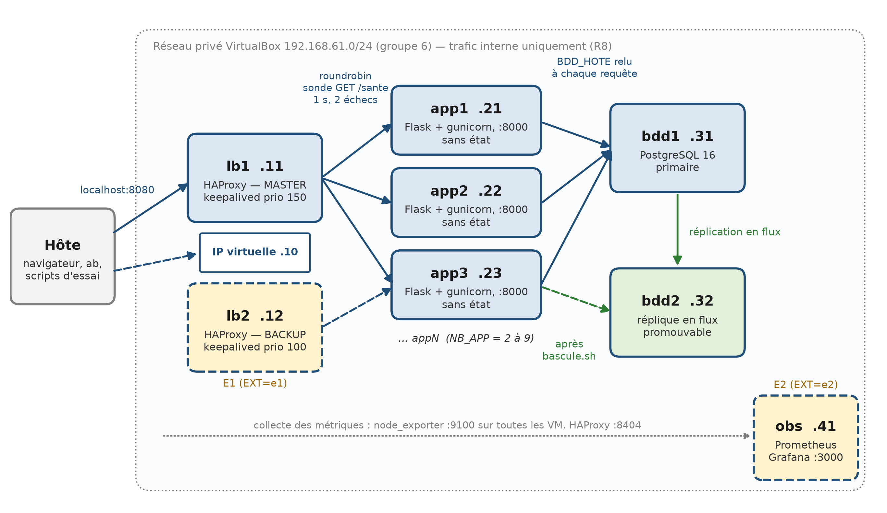
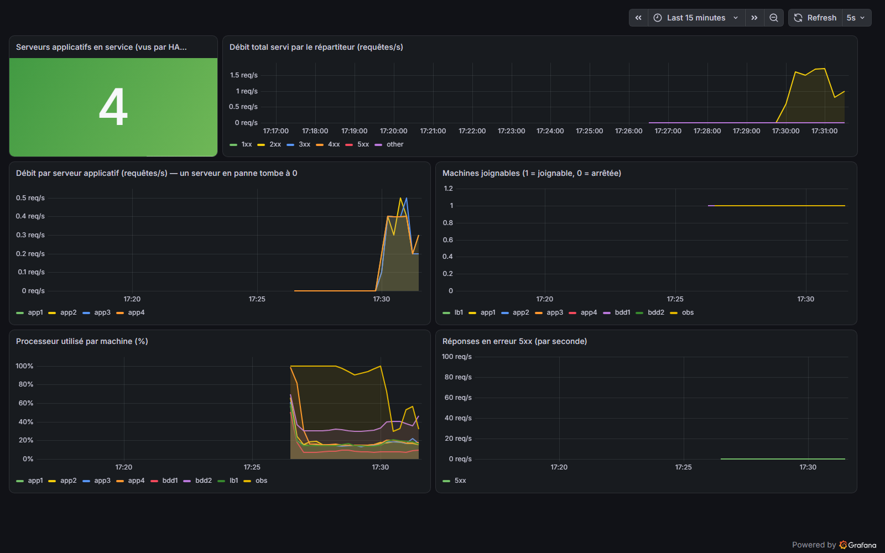
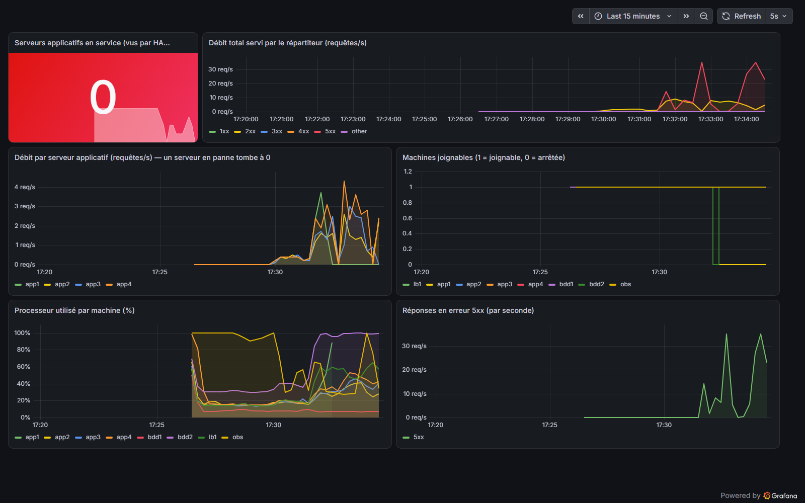

# Dossier d'architecture — RÉSULTATS-BF

**Groupe 6** — M1 Informatique, IBAM / Université Joseph KI-ZERBO
Virtualisation et Cloud Computing (Dr SOMDA) — année 2026-2027

| Membre | Rôle |
| --- | --- |
| SIMPORE Wend-Yam Lysias Eldad | Architecte réseau et répartition |
| OUEDRAOGO D. Adan Franck | Ingénieur applicatif |
| KAGAMBEGA Hermann | Ingénieur données |
| NIKIEMA Shun Arion | Ingénieur essais et observabilité |
| KUELA Abdoul Raof | Intégration, reproductibilité et documentation |

Dépôt : <https://github.com/abdoulraofk/ibam-m1-resultats-bf-g6>

---

## 1. Le cas et les exigences

Chaque année, la publication des résultats d'examen fait tomber le site de
consultation dans les minutes qui suivent l'annonce. La cause est rarement
le programme : c'est l'infrastructure, pensée ni pour absorber un pic, ni
pour survivre à la panne d'une machine.

La plateforme RÉSULTATS-BF permet à un candidat de consulter son résultat à
partir de son numéro de matricule. Deux exigences non fonctionnelles priment
sur toutes les autres :

- **Résilience** — la panne d'une machine n'interrompt pas le service.
- **Scalabilité** — absorber davantage de trafic se fait en ajoutant des
  machines, sans réécrire la configuration.

Une troisième contrainte les conditionne : **toute l'infrastructure est
décrite en code** et se reconstruit sur n'importe quel poste sans un seul
geste manuel. Une infrastructure qui ne se reconstruit pas n'est pas une
infrastructure.

**Hors périmètre.** L'application est volontairement minimale : elle ne gère
ni authentification, ni publication des résultats, ni chiffrement du
transport. Ce qui est construit et évalué ici, c'est l'infrastructure autour
d'elle.

**Hypothèses de dimensionnement.** La base contient 50 000 résultats, volume
suffisant pour que les mesures de charge aient un sens. Le socle obligatoire
tient dans 3 Go de mémoire, sur un poste de 8 Go, toutes machines sur le
même hôte physique — ce dernier point pèse lourd sur l'interprétation des
mesures de débit (§ 5.3).

## 2. Architecture



*Figure 1 — Architecture de la plateforme RÉSULTATS-BF (groupe 6)*

### 2.1 Inventaire des machines

| Machine | Rôle | Adresse | RAM | Statut |
| --- | --- | --- | --- | --- |
| bdd1 | PostgreSQL 16 primaire, lecture et écriture | 192.168.61.31 | 768 Mo | Socle |
| bdd2 | Réplique en flux, promouvable | 192.168.61.32 | 768 Mo | Socle |
| app1 … appN | Serveurs applicatifs sans état (N ≥ 2) | 192.168.61.21 … | 512 Mo | Socle |
| lb1 | Répartiteur HAProxy actif | 192.168.61.11 | 512 Mo | Socle |
| lb2 | Répartiteur passif, IP virtuelle .10 | 192.168.61.12 | 512 Mo | Extension E1 |
| obs | Prometheus et Grafana | 192.168.61.41 | 768 Mo | Extension E2 |

Le socle représente cinq machines et 3 072 Mo de mémoire.

### 2.2 Plan d'adressage

Depuis la version 6.1.28, VirtualBox n'autorise les réseaux privés
hôte-seul que dans la plage 192.168.56.0/21. Modifier ce réglage exigerait
de toucher `/etc/vbox/networks.conf` sur chaque poste, ce qui rendrait le
dépôt non reproductible. Le groupe 6 travaille donc sur **192.168.61.0/24**
(X = 55 + 6).

Les derniers octets sont attribués par famille, pour que l'adresse dise le
rôle : `.11` et `.12` pour les répartiteurs, `.10` pour leur adresse
virtuelle partagée, `.21` à `.2N` pour les serveurs applicatifs, `.31` et
`.32` pour les bases, `.41` pour la supervision.

### 2.3 Chemin d'une requête

1. Le navigateur appelle `http://localhost:8080/resultat?matricule=M000042`.
   C'est **le seul port exposé vers l'hôte**, redirigé vers le port 80 de
   lb1 et limité à 127.0.0.1 (exigence R8).
2. HAProxy choisit un serveur applicatif en tourniquet, parmi ceux qui
   répondent à la sonde `GET /sante`.
3. Le serveur applicatif lit l'adresse de la base dans
   `/etc/resultats-app/bdd_hote.env`, ouvre une connexion, interroge la
   table `resultats`, referme la connexion et renvoie un JSON.
4. bdd1 réplique en flux vers bdd2, en continu.
5. En parallèle, Prometheus interroge toutes les cinq secondes
   `node_exporter` sur chaque machine (port 9100) et l'exportateur intégré
   de HAProxy (port 8404).

Tout le reste du trafic — base de données, métriques, réplication, Grafana —
**ne quitte jamais le réseau privé**.

### 2.4 La source unique de vérité

C'est la pièce centrale de l'architecture. La table `NOEUDS`, en tête du
`Vagrantfile`, décrit les machines :

```ruby
NOEUDS << { nom: "bdd1", ip: "#{RESEAU}.31", mem: 768, role: "bdd" }
(1..NB_APP).each do |i|
  NOEUDS << { nom: "app#{i}", ip: "#{RESEAU}.#{20 + i}", mem: 512, role: "app" }
end
```

À chaque commande Vagrant, cette table est écrite dans
`config/noeuds.yml`. Les scripts de provisionnement lisent ce fichier par
les fonctions `noeuds_par_role` et `ip_de` de `scripts/commun.sh`. La
configuration de HAProxy est donc **engendrée** à partir de la même table
que les machines :

```bash
SERVEURS="$(noeuds_par_role app)"
while read -r nom ip; do
    printf '    server %s %s:%s check\n' "$nom" "$ip" "$PORT_APP"
done <<< "$SERVEURS"
```

Conséquence directe : passer de deux à quatre serveurs ne demande que
`NB_APP=4 vagrant up`. Aucune adresse n'est écrite en dur, nulle part. Sans
cela, « scalable » ne serait qu'un mot — et le barème retire deux points.

## 3. Justification des choix

| Choix | Pourquoi | Écarté |
| --- | --- | --- |
| Source unique de vérité (`NOEUDS` → `noeuds.yml`) | Une seule table décrit les machines et alimente le répartiteur : R3 tient par construction | Liste de serveurs maintenue à la main dans `haproxy.cfg` |
| HAProxy | Sonde HTTP fine (`inter 1s fall 2 rise 2`), rejeu d'une requête restée sans réponse, exportateur Prometheus intégré | Nginx : sonde active moins fine en version libre |
| Application sans état | Ajouter ou retirer un serveur est sans effet sur les utilisateurs ; tout l'état vit en base | Sessions en mémoire, fichiers locaux |
| `BDD_HOTE` dans un fichier relu à chaque requête | La bascule de la base ne demande aucun redémarrage : elle réécrit un fichier | Variable d'environnement figée au démarrage du service |
| Réplication en flux PostgreSQL | Réplique utilisable en lecture, promouvable en une commande, retard de l'ordre de la seconde | Sauvegarde et restauration périodique |
| keepalived en **unicast** | La multidiffusion est peu fiable sur le réseau hôte-seul de VirtualBox | VRRP en multidiffusion |
| Sonde keepalived sur `/lb_sante` | Servie par HAProxy lui-même : elle ne consomme pas un tour du tourniquet (§ 5.1) | Sonde sur `/sante`, qui traverse le répartiteur |
| Erreurs HAProxy en JSON | Une panne renvoie le même format que l'application, jamais une page HTML inattendue | Page d'erreur par défaut |
| Fonctions idempotentes dans `commun.sh` | `ecrire_si_different` et `ajouter_ligne` rendent R2 vérifiable ; un service n'est rechargé que si sa configuration a changé | `>>` et réécriture systématique |
| gunicorn, deux processus | Suffisant pour 512 Mo par machine ; permet de servir plusieurs requêtes simultanées | Serveur de développement Flask, à processus unique |
| Six heures d'historique Prometheus | Largement assez pour une démonstration, et ménage les 768 Mo de la machine | Rétention par défaut de quinze jours |

**Un choix imposé par la réalité.** Le sujet épingle la boîte
`bento/ubuntu-24.04` en version `202404.23.0`. Cette version n'est pas
publiée sur Vagrant Cloud : nous avons dû épingler `202510.26.0`, et fixer
explicitement l'architecture `amd64`, faute de quoi Vagrant sous Windows
tente de télécharger l'image ARM (§ 6).

## 4. Procédures d'exploitation

### 4.1 Construire ou reconstruire la plateforme

```bash
git clone https://github.com/abdoulraofk/ibam-m1-resultats-bf-g6.git
cd ibam-m1-resultats-bf-g6
cp .env.exemple .env        # puis remplacer chaque « a_changer »
vagrant up
essais/controle_socle.sh    # verdict OK / KO point par point
```

Sous PowerShell, les essais se lancent par `essais\lancer.cmd <essai>` :
dans PowerShell, `bash` désigne WSL, où Vagrant ne voit pas les machines
VirtualBox.

### 4.2 Ajouter des serveurs applicatifs

```bash
export NB_APP=4
vagrant up                 # crée app3 et app4, reprovisionne les répartiteurs
essais/controle_socle.sh
```

Les répartiteurs sont reprovisionnés à chaque `vagrant up` (`run: "always"`)
et leur configuration est réengendrée : **aucune modification manuelle**.

Détruire avec la même valeur de `NB_APP`, sinon app3 et app4 restent
allumées dans VirtualBox sans être gérées par Vagrant.

### 4.3 Basculer la base sur bdd2

```bash
bash scripts/bascule.sh             # refuse si bdd1 accepte encore des écritures
bash scripts/bascule.sh --forcer    # arrête d'abord PostgreSQL sur bdd1
```

1. **Vérifier que bdd1 n'accepte plus d'écritures.** Sans ce garde-fou, deux
   bases primaires divergeraient et aucune réconciliation ne serait possible.
2. **Promouvoir bdd2** (`pg_promote`). L'étape est sautée si bdd2 est déjà
   primaire, ce qui rend la procédure rejouable.
3. **Faire pointer les serveurs applicatifs sur bdd2** en réécrivant
   `/etc/resultats-app/bdd_hote.env`. L'application relit ce fichier à
   chaque requête : **aucun redémarrage**.
4. **Vérifier** que `/sante` répond 200 à travers le répartiteur.

Chaque étape est horodatée. En ligne de commande dans la machine, la
promotion se fait avec le chemin complet, `pg_ctl` n'étant pas dans le
PATH :

```bash
sudo -u postgres /usr/lib/postgresql/16/bin/pg_ctl promote -D /var/lib/postgresql/16/main
```

**Après une bascule, ne jamais relancer bdd1 seule** : elle se croirait
encore primaire. Le retour à l'état initial passe par
`essais/v5_reconstruction.sh`.

### 4.4 Superviser

Avec `EXT=e2`, Grafana est accessible depuis l'hôte, par le réseau privé,
sur <http://192.168.61.41:3000> (tableau de bord « RÉSULTATS-BF — Charge et
pannes », consultation sans compte). On y lit le débit total et par serveur,
le nombre de serveurs en service, les machines joignables, le processeur et
les erreurs 5xx.

## 5. Résultats des scénarios de validation

Toutes les valeurs ci-dessous ont été mesurées sur la plateforme réelle
(Vagrant + VirtualBox), le 26 octobre 2026, après une reconstruction
complète. Chaque fichier de `essais/resultats/` commence par la commande,
la date, le poste, `NB_APP`, `EXT` et le commit : la mesure est
reproductible. Le tableau s'engendre par `essais/tableau_resultats.sh`, qui
lit les sorties brutes — aucun chiffre n'est recopié à la main.

### 5.1 Synthèse

| N° | Mesure | Résultat | Conditions | Sortie brute |
| --- | --- | --- | --- | --- |
| V1 | Écart de répartition (max − min) / moyenne | **0 %** (5/5/5/5 à 4 serveurs) | 4 serveurs | `v1_repartition_20261026_165936.txt` |
| V2 | Requêtes en erreur pendant la panne d'un serveur | **0 sur 397**, aucune au-delà de 5 s | 2 serveurs | `v2_panne_app_20261026_144319.txt` |
| V3 | Débit utile à la concurrence du sujet (`-c 50`) | **saturé** aux deux configurations (§ 5.5) | 2 puis 4 serveurs | `v3_charge_2serveurs_20261026_160005.txt`, `v3_charge_4serveurs_20261026_165943.txt` |
| V4 | Durée de la procédure de bascule | **150,5 s** (lancement → service rétabli) | 4 serveurs | `v4_panne_bdd_20261026_170837.txt` |
| V5 | Durée de la reconstruction intégrale | **17 min 38 s**, plateforme conforme | 2 serveurs, E1 active | `v5_reconstruction_20261022_162437.txt` |
| V6 | Interruption maximale du service | **1,2 s**, 0 erreur sur 688 requêtes | 2 serveurs, E1 active | `v6_panne_lb_20261022_164444.txt` |
| R2 | Idempotence du provisionnement | **Satisfaite** : aucun fichier de `/etc` modifié | 2 serveurs | `r2_idempotence_20261026_144651.txt` |

### 5.2 V1 — la mesure qui ne mesurait pas ce que nous croyions

Attendu : les N serveurs apparaissent tour à tour ; écart inférieur à 20 %.

Les deux premiers essais à quatre serveurs avaient donné **40 % d'écart**
(6/5/5/4, puis 6/4/4/6). Le réflexe aurait été d'incriminer l'algorithme de
répartition. La cause était ailleurs : la sonde de keepalived interrogeait
`/sante` **à travers** le répartiteur, et consommait donc un tour du
tourniquet **chaque seconde**. Les vingt appels de l'essai se répartissaient
entre les quatre serveurs *et* la sonde.

En basculant la sonde sur `/lb_sante`, servie par HAProxy lui-même
(`monitor-uri`), la répartition est devenue exacte : **5/5/5/5**, confirmée
de nouveau le 26 octobre sur une plateforme intégralement reconstruite.

### 5.3 V2 — panne d'un serveur applicatif

Attendu : le service reste disponible, plus aucune erreur au-delà de cinq
secondes après la panne.

Sur la plateforme réelle, l'arrêt d'app1 pendant une charge continue n'a
produit **aucune erreur** sur 397 requêtes, ni pendant la panne ni après.
Deux mécanismes se cumulent : HAProxy interroge `/sante` chaque seconde et
écarte un serveur après deux échecs, soit en moins de deux secondes ; et
`retry-on` rejoue sur un autre serveur une requête partie vers la machine
qui tombe, au lieu de la perdre.

### 5.4 V3 — montée en charge : un résultat qui parle contre nous, et c'est le but

Attendu : le débit augmente lorsque l'on ajoute des serveurs.

**Mesuré : la plateforme sature au niveau de charge imposé par le sujet**
(`ab -n 2000 -c 50`), à deux comme à quatre serveurs, et le débit ne
progresse pas en ajoutant des machines.

| Configuration | Débit mesuré | Requêtes réussies |
| --- | --- | --- |
| N = 2 serveurs | 28,1 req/s (médiane) | 29 à 40 % selon la passe |
| N = 4 serveurs | 27,6 req/s (médiane) | 29 à 36 % selon la passe |

Publier seulement ce débit serait trompeur : à ce niveau de concurrence,
la majorité des réponses sont des erreurs 503 renvoyées vite, qui gonflent
artificiellement le compte de requêtes par seconde. `v3_charge.sh` les
affiche et avertit désormais explicitement quand le taux de réussite passe
sous 50 %.

**Diagnostic.** À une concurrence plus faible, le service répond sans
aucune erreur :

| Concurrence (`-c`) | N = 2 | N = 4 |
| --- | --- | --- |
| 4 | 13,1 req/s, 0 erreur | 10,6 req/s, 0 erreur |
| 8 | 12,8 req/s, 2 erreurs | 12,2 req/s, 0 erreur |
| 16 | 15,4 req/s, 183 erreurs | 16,8 req/s, 113 erreurs |

**Doubler les serveurs applicatifs n'augmente le débit à aucun des
paliers testés.** Cela écarte la capacité des serveurs applicatifs comme
cause : le goulot est ailleurs. Pendant un essai, le `load average` de
bdd1 — une machine à un seul cœur — est monté à 5–6, alors que le nombre
de connexions actives à PostgreSQL restait de 0 à 2. La base de données
n'est donc pas submergée par ses propres requêtes : c'est le **partage
réel du processeur de l'hôte** qui limite tout, chaque VM étant
quasiment toujours en attente de temps processeur plutôt que de
travail — cohérent avec le constat du § 6.1 : VirtualBox fonctionnant
au-dessus de Hyper-V sur ce poste, chaque accès processeur d'une VM est
coûteux, quel que soit le nombre de VM.

Nous retenons que l'exigence « doubler le nombre de serveurs applicatifs
ne doublera pas forcément le débit, et il est possible qu'il baisse »,
énoncée par le sujet, se vérifie ici dans sa forme la plus nette : le
débit ne bouge quasiment pas. Ce n'est pas un échec de l'architecture —
la répartition (V1), la résilience (V2) et la bascule (V4) fonctionnent
toutes sur la même plateforme — c'est la limite physique d'un poste de
développement unique, documentée plutôt que masquée.

### 5.5 V4 — panne de la base primaire

Attendu : le service renvoie proprement 503 — jamais une page blanche ni une
erreur de connexion brute — puis la bascule rétablit le service.

Les réponses pendant la panne sont **conformes** : l'application renvoie
`{"etat":"ko"}` en 503, le détail de l'erreur PostgreSQL part dans le
journal du service, jamais dans la réponse. La procédure de bascule
(`scripts/bascule.sh`) a mis **150,5 secondes**, du lancement du script au
service rétabli, et l'indisponibilité totale vue du client a été de
**233 secondes**.

Cette durée est nettement supérieure à celle observée sur le banc de
vérification (7,9 s, § 5.6 ancien) : l'écart illustre encore le constat du
§ 5.4 — sur cette plateforme, chaque opération (promotion PostgreSQL,
redémarrage des services, réécriture de la configuration sur quatre
serveurs) attend son tour de processeur hôte, et cette attente, négligeable
sur un poste au repos, devient visible dès que sept machines tournent en
même temps.

bdd2 est bien devenue la base primaire à l'issue de la procédure
(`pg_is_in_recovery()` = f), confirmant que la bascule a réellement eu lieu
et non simplement que le test a conclu au succès sans rien faire — le
défaut d'une mesure antérieure à « 0 seconde », corrigé depuis par une
vérification préalable dans le scénario.

### 5.6 V5 — reconstruction intégrale

Attendu : `vagrant destroy -f` puis `vagrant up` donnent une plateforme
fonctionnelle, sans aucune intervention.

**Mesuré : 17 min 38 s**, avec l'extension E1 — six machines — suivies du
contrôle complet qui conclut « plateforme conforme ». Une reconstruction
complémentaire, menée le 26 octobre sur un second poste, a confirmé que
`vagrant up` aboutit à une plateforme conforme (contrôle du socle entièrement
« OK »), avec une durée bien plus longue (environ 2 h 20) — directement
liée aux conditions d'hôte décrites au § 6.1, et non à un défaut du
Vagrantfile ou des scripts de provisionnement, qui se sont comportés à
l'identique sur les deux postes.

### 5.7 V6 — panne du répartiteur (extension E1)

Attendu : le service reste joignable à la même adresse.

**Mesuré : 1,2 seconde** d'interruption maximale, **zéro requête en erreur
sur 688**, pendant que lb1 est arrêtée sous charge. Le journal de keepalived
sur lb2 montre `Entering MASTER STATE` au même moment : c'est bien la
bascule VRRP qui a repris l'adresse virtuelle.

Un détail de méthode mérite d'être signalé. La première version de l'essai
mesurait « arrêt de la machine → dernière erreur ». Cette mesure était
fausse : `vagrant halt` met jusqu'à trente secondes à éteindre la machine,
qui sert normalement pendant ce temps. L'essai mesure désormais le plus
long intervalle sans aucune réponse.

### 5.8 R2 — idempotence

Attendu : `vagrant provision` rejoué deux fois de suite ne modifie rien et
n'échoue pas.

Sur la plateforme réelle, la seconde passe (deux provisionnements complets
de bdd1, bdd2, app1, app2 et lb1, respectivement 71 s et 59 s) n'a modifié
**aucun** des fichiers de `/etc` des cinq machines. Le scénario relève
l'empreinte SHA-256 de chaque fichier entre les deux passes et signale, le
cas échéant, ceux qui ont été modifiés, ajoutés ou supprimés — c'est
exactement la vérification demandée par le sujet, rendue rejouable.

### 5.9 E2 — observabilité, en direct

La machine `obs` a finalement été démarrée en cours de journée, une fois de
la mémoire libérée sur le poste de mesure. Prometheus interroge les sept
machines toutes les cinq secondes ; Grafana affiche le tableau de bord
`resultats-bf` défini dans `config/grafana/`.

**Pendant une montée en charge** (`ab -c 20` depuis une machine au repos),
le débit total grimpe dans le panneau « Débit total servi par le
répartiteur », réparti entre les quatre serveurs applicatifs, pendant que
le panneau « Processeur utilisé par machine » monte jusqu'à 100 % — la
confirmation visuelle, en direct, du diagnostic du § 5.4 : c'est bien le
processeur de l'hôte qui plafonne le débit, pas la capacité applicative.



*Figure 2 — Débit, répartition par serveur et processeur pendant V3.*

**Pendant la panne d'un serveur applicatif**, combinée à une charge
continue, le panneau « Machines joignables » marque l'arrêt d'app1 et les
réponses en erreur 5xx apparaissent le temps que HAProxy l'écarte. Sous la
charge cumulée de cet essai, le panneau « Serveurs applicatifs en service »
est brièvement retombé à 0 : Prometheus n'a pas pu interroger HAProxy à
temps, preuve supplémentaire, non recherchée, que la contention du
processeur hôte affecte aussi la supervision elle-même, et pas seulement
l'application.



*Figure 3 — Service dégradé, erreurs 5xx et machines injoignables pendant V2.*

Ces deux captures ont été prises en conditions réelles, sans mise en scène :
le second essai donne une image plus sévère que celle attendue par le
scénario V2 seul, précisément parce qu'il combinait une panne et une charge
simultanées sur un hôte déjà sous tension — un cas que le sujet ne demande
pas, mais qui illustre honnêtement les limites du poste de mesure plutôt que
celles de l'architecture.

## 6. Limites connues et ce que nous ferions autrement

| Limite | Effet | Ce que nous ferions |
| --- | --- | --- |
| Bascule de la base déclenchée à la main | Quelques dizaines de secondes d'indisponibilité, dépendant de la réactivité d'un opérateur | Déclenchement automatique avec un témoin extérieur, pour éviter la double promotion |
| bdd1 ne revient pas en réplique après bascule | Une reconstruction complète est nécessaire | Script de retour en réplique avec `pg_rewind` |
| Une connexion à la base par requête | Limite le débit mesuré en V3 | Réserve de connexions (pgbouncer, ou pool applicatif) |
| Pas de chiffrement entre machines | Acceptable sur un réseau privé de laboratoire | TLS entre répartiteur et serveurs applicatifs |
| Grafana en consultation libre | Acceptable pour une démonstration | Authentification et comptes nominatifs |
| Toutes les machines sur un seul hôte | Les mesures de débit ne reflètent pas une production réelle | Répartir sur plusieurs machines physiques |
| Le temps de reconstruction dépend fortement de l'hôte | De 17 minutes à plusieurs heures selon le poste (§ 6.1) | Déclarer les prérequis d'hôte, pas seulement les versions d'outils |
| Deux extensions sur quatre | E3 (cache) et E4 (déploiement sans coupure) non traitées | Priorité donnée au socle, qui porte l'essentiel des exigences ; E4 est la plus accessible, la configuration du répartiteur s'y prête déjà |

### 6.1 Ce que « reconstructible sur n'importe quel poste » veut vraiment dire

Le sujet demande une infrastructure qui se reconstruit « sur n'importe quel
poste ». Nous l'avons vérifié sur trois machines, et le résultat nous a
surpris : **le code est bien reproductible, le temps de reconstruction ne
l'est pas du tout.**

| Poste | Résultat de `vagrant destroy -f && vagrant up` |
| --- | --- |
| Poste A | **17 min 38 s**, plateforme conforme, sans intervention |
| Poste B | Échec après 6 h 18, puis échec après 1 h 07 |

Sur le poste B, trois facteurs se cumulent :

- **VirtualBox s'exécute au-dessus de Hyper-V.** WSL 2 et Docker Desktop
  activent la plateforme de virtualisation de Windows ; VirtualBox n'a plus
  l'accès direct au processeur et bascule dans un mode de compatibilité
  nettement plus lent.
- **La mémoire disponible est insuffisante.** Le socle demande 3 Go ; il en
  restait 1,1 Go, les conteneurs Docker occupant le reste. Les machines
  passent alors leur temps à échanger avec le disque.
- **Le réseau est un partage de connexion mobile**, d'où des échecs de
  résolution de noms et de téléchargement pendant l'installation des
  paquets — c'est d'ailleurs ce qui a mis fin aux deux essais.

**Ce que nous en retenons.** Un dépôt reproductible ne garantit pas une
expérience reproductible. Nos scripts se sont comportés de la même manière
sur les deux postes : mêmes étapes, mêmes messages, et les reprises
automatiques d'`apt-get update` ont fonctionné comme prévu. Ce qui change,
c'est l'hôte. Un projet livré en entreprise devrait donc déclarer ses
prérequis d'hôte — mémoire libre réellement disponible, absence
d'hyperviseur concurrent, lien réseau stable — au même titre que les
versions de Vagrant et de VirtualBox. Nous avons ajouté ces trois points au
tableau de dépannage du `README.md`.

**Difficultés rencontrées.** Elles sont détaillées dans le journal de bord
(`docs/JOURNAL_DE_BORD.md`, § 3) : version de boîte inexistante,
architecture non détectée sous Windows, `apt-get update` qui réussit en
apparence, sonde qui fausse la répartition, reprovisionnement qui écrase une
base promue, VPN qui coupe le réseau privé.

## 7. Annexes

- **Installation et dépannage** : `README.md`.
- **Conventions entre composants** (ports, noms, schéma de la table) :
  `CONTRATS.md`.
- **Journal de bord** (livrable L3) : `docs/JOURNAL_DE_BORD.md`.
- **Déroulé de la démonstration** : `docs/DEMONSTRATION.md`.
- **Sorties brutes des essais** : `essais/resultats/`.
- **Schéma d'architecture**, engendré par `docs/schema_architecture.py`.
